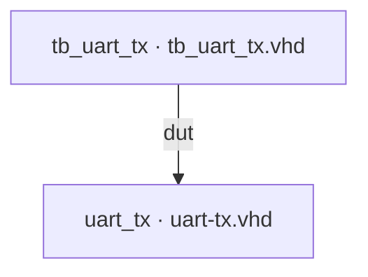

# Codemap: UART_TX

← [README](README.md)

> Generated from commit `556e36c` by `scripts/codemap.py`. Regenerate it from the workspace root with `python3 scripts/codemap.py UART_TX`; don't edit it by hand.

## Design

### `tb_uart_tx` (`tb_uart_tx.vhd`)

- **In:** -
- **Out:** -

### `uart_tx` (`uart-tx.vhd`)

- **In:** `i_clk`, `i_reset`, `i_go`, `i_data`
- **Out:** `o_done`, `o_data`
- **Generics:** `MAX_COUNT`
