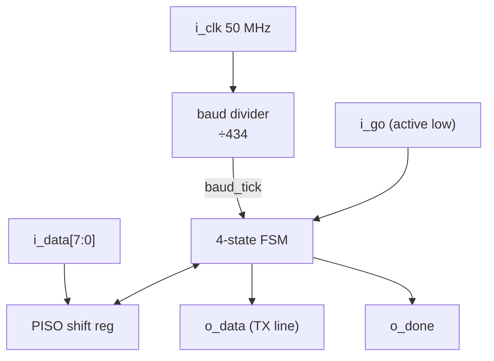
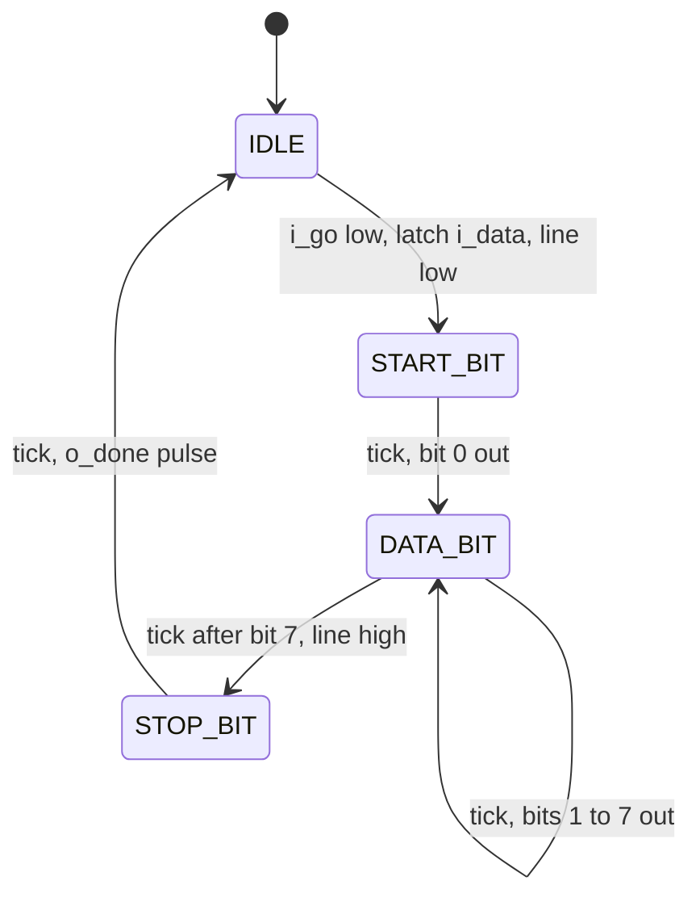

# UART Transmitter

> A from-scratch UART TX module in VHDL: 50 MHz clock in, 115,200 baud 8N1 out.


## Overview

One synthesizable file, `uart-tx.vhd`. It latches an 8-bit bus, shifts it out LSB-first through a PISO register, and frames it with start and stop bits. It's the hardware half of meeting bare-metal C in the middle.

## Architecture



`50,000,000 / 434 ≈ 115,207 baud` (+0.006 %). The divider rests at 0 while idle and restarts with every frame, so each bit lasts exactly 434 clocks.

## State Machine



## Frame

```
 i_go ‾‾‾‾\_/‾‾‾‾‾‾‾‾‾‾‾‾‾‾‾‾‾‾‾‾‾‾‾‾‾‾‾‾‾‾‾‾‾‾‾‾‾‾‾‾‾‾‾‾‾
 o_data‾‾‾‾\_____/ b0 X b1 X b2 X b3 X b4 X b5 X b6 X b7 /‾‾‾‾‾‾
           │start│◄──────── 8 × 434 clocks ─────────►│stop│
 o_done ____________________________________________________/\_
           └──────────── 10 × 434 = 4,340 clocks ──────────┘
```

## Port Map

| Port | Dir | Width | Description |
|---|---|---|---|
| `i_clk` | in | 1 | 50 MHz system clock |
| `i_reset` | in | 1 | Active-low asynchronous reset |
| `i_go` | in | 1 | Active-low start. Seen on any clock, so a 1-clock pulse works; ignored mid-frame and on the clock right after `o_done`. Hold it low to stream back-to-back bytes |
| `i_data` | in | 8 | Byte to send, latched the clock `i_go` is seen. When streaming, put the next byte on it in response to `o_done` |
| `o_data` | out | 1 | Serial TX line, idles high |
| `o_done` | out | 1 | One-clock pulse when the stop bit ends |

## Simulation

```bash
ghdl -a --std=08 uart-tx.vhd tb_uart_tx.vhd
ghdl -e --std=08 tb_uart_tx
ghdl -r --std=08 tb_uart_tx --vcd=tb_uart_tx.vcd   # prints PASS or the failing bit
```

`tb_uart_tx.vhd` sends four bytes (`A5`, `3C`, `00`, `FF`), each with a one-clock `i_go` pulse. It samples every bit in the middle of its period and checks that `o_done` is high for exactly one clock, 10 bit periods after the edge that saw `i_go`. It sets `MAX_COUNT` to 8 so the waveform stays short; at 434, `o_done` comes 4,340 clocks after that edge, and streamed frames start 4,342 clocks apart.

**Codemap:** [CODEMAP.md](CODEMAP.md), the entities, ports and processes, generated from the code.

---
*powered by logic, coffee, and many sleepless nights*
